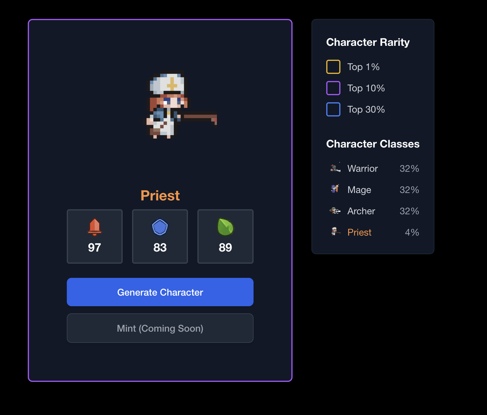

# ⚔️ Random Character Generator

Simple character rolling application using MagicBlock verifiable random function (VRF) to generate random numbers for character stats. This is extended from the [MagicBlock roll dice example](https://github.com/magicblock-labs/magicblock-engine-examples/tree/main/roll-dice).

# Demo



[https://mb-vrf.vercel.app/](https://mb-vrf.vercel.app//)

## Software Packages

This program has utilized the following software packages.

| Software   | Version | Installation Guide                                              |
| ---------- | ------- | --------------------------------------------------------------- |
| **Solana** | 2.1.6   | [Install Solana](https://docs.anza.xyz/cli/install)             |
| **Rust**   | 1.82    | [Install Rust](https://www.rust-lang.org/tools/install)         |
| **Anchor** | 0.31.0  | [Install Anchor](https://www.anchor-lang.com/docs/installation) |

```sh
# Check and initialize your Solana version
agave-install list
agave-install init 2.1.6

# Check and initialize your Rust version
rustup show
rustup install 1.82

# Check and initialize your Anchor version
avm list
avm use 0.31.0
```

## ✨ Build and Test

Build the program:

```bash
anchor build
```

Run the tests:

```bash
anchor test --skip-deploy --skip-build --skip-local-validator
```

## 🚀 Launch the Frontend

To start the frontend application locally:

```bash
cd app
```

Install dependencies:

```bash
yarn install
```

Start the development server:

```bash
yarn dev
```

The application will be available at `http://localhost:3000` (or another port if 3000 is already in use).
